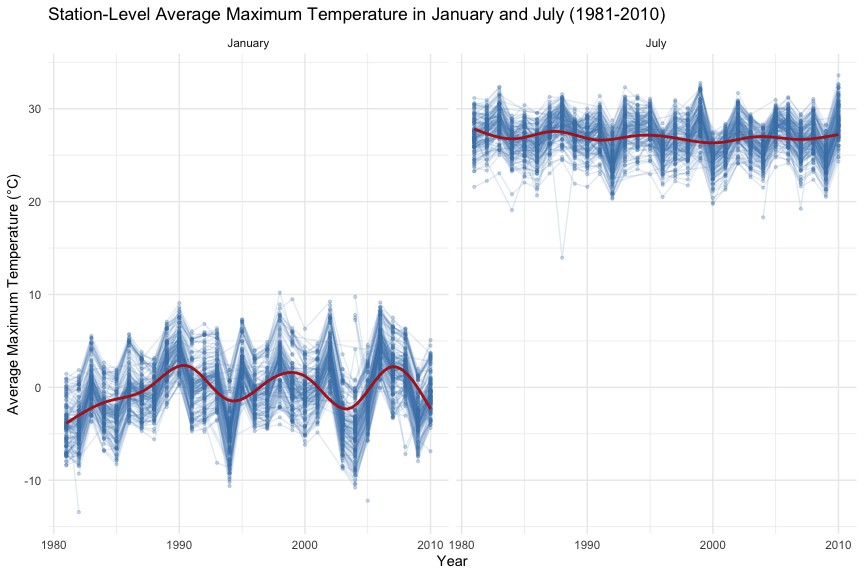
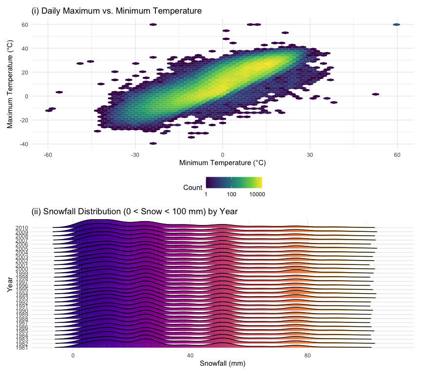
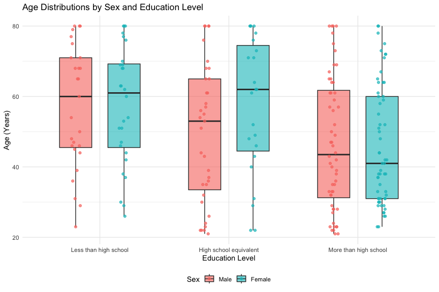
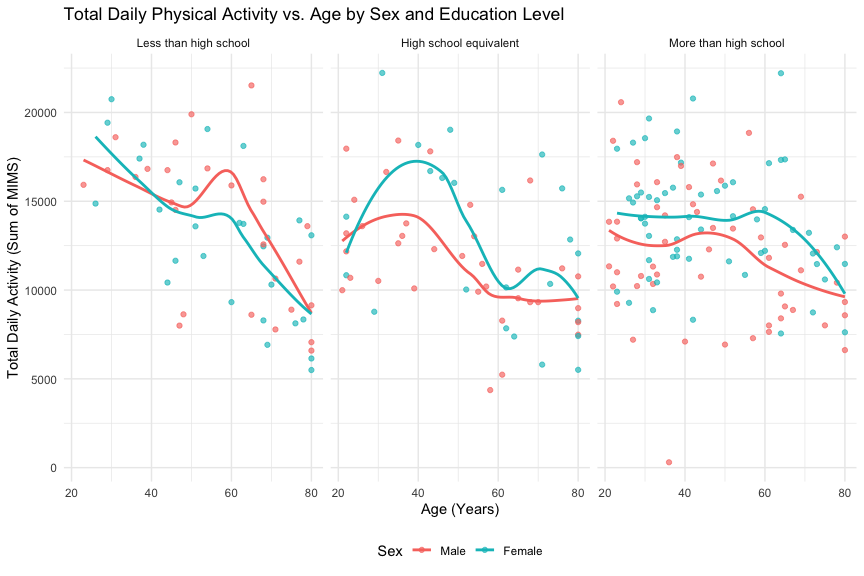
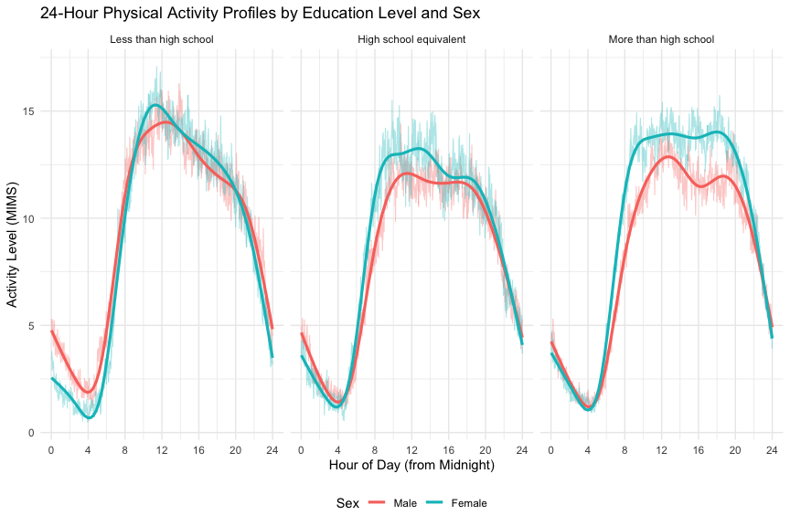

Homework 3
================
Zhiquan Chen

# Problem 1

``` r
data("ny_noaa")

noaa_missing =
  ny_noaa |>
  summarise(
    prop_prcp_na = mean(is.na(prcp)),
    prop_snow_na = mean(is.na(snow)),
    prop_snwd_na = mean(is.na(snwd)),
    prop_tmax_na = mean(is.na(tmax)),
    prop_tmin_na = mean(is.na(tmin))
  )
```

The `ny_noaa` dataset contains daily weather observations from 747 New
York state weather stations spanning from 1981-01-01 to 2010-12-31, with
2,595,176 rows and 7 columns. Key variables include weather station
identifier (`id`), observation date (`date`), precipitation in tenths of
millimeters (`prcp`), snowfall in millimeters (`snow`), snow depth in
millimeters (`snwd`), and maximum and minimum temperatures in tenths of
degrees Celsius (`tmax` and `tmin`). Missing data is a substantial issue
because many stations only record a subset of meteorological variables:
`tmax` and `tmin` are each missing in 43.71% and 43.71% of observations,
`snwd` is missing in 22.80%, `snow` is missing in 14.69%, and `prcp` is
missing in 5.62%.

``` r
noaa_df =
  ny_noaa |>
  separate(
    date,
    into = c("year", "month", "day"),
    sep = "-",
    convert = TRUE
  ) |>
  mutate(
    prcp = prcp / 10,
    tmax = as.numeric(tmax) / 10,
    tmin = as.numeric(tmin) / 10
  )

snow_top =
  noaa_df |>
  filter(!is.na(snow)) |>
  count(snow, sort = TRUE) |>
  slice_head(n = 5)

kable(
  snow_top,
  col.names = c("Snowfall (mm)", "Observations"),
  caption = "Top 5 Most Commonly Observed Snowfall Values"
)
```

| Snowfall (mm) | Observations |
|--------------:|-------------:|
|             0 |      2008508 |
|            25 |        31022 |
|            13 |        23095 |
|            51 |        18274 |
|            76 |        10173 |

Top 5 Most Commonly Observed Snowfall Values

I separated `date` into integer `year`, `month`, and `day` variables,
and converted `prcp` from tenths of millimeters to millimeters (`mm`) as
well as `tmax` and `tmin` from tenths of degrees Celsius to degrees
Celsius (`°C`), so that precipitation, snowfall, and snow depth are all
measured in `mm` and temperatures in `°C`. For snowfall, the most
commonly observed value is `0` mm (2,008,508 observations), because snow
does not fall on the vast majority of days across the year in New York
State. The next most common values are `25` mm, `13` mm, `51` mm, and
`76` mm, which correspond to historical measurements recorded in
imperial inches (1.0 inch = 25.4 mm, 0.5 inch = 12.7 mm, 2.0 inches =
50.8 mm, and 3.0 inches = 76.2 mm) and subsequently rounded to the
nearest millimeter.

``` r
jan_july_tmax =
  noaa_df |>
  filter(month %in% c(1, 7), !is.na(tmax)) |>
  mutate(
    month = factor(
      month,
      levels = c(1, 7),
      labels = c("January", "July")
    )
  ) |>
  group_by(id, year, month) |>
  summarise(
    mean_tmax = mean(tmax, na.rm = TRUE),
    .groups = "drop"
  )

ggplot(jan_july_tmax, aes(x = year, y = mean_tmax, group = id)) +
  geom_line(alpha = 0.15, color = "steelblue") +
  geom_point(alpha = 0.25, size = 0.8, color = "steelblue") +
  geom_smooth(aes(group = 1), color = "firebrick", se = FALSE, linewidth = 1) +
  facet_grid(. ~ month) +
  labs(
    title = "Station-Level Average Maximum Temperature in January and July (1981-2010)",
    x = "Year",
    y = "Average Maximum Temperature (°C)"
  )
```



The two-panel plot shows a clear seasonal separation: average maximum
temperatures in January generally fluctuate between -10 °C and 10 °C
(centered near 0 °C), whereas July average maximum temperatures stay
much warmer and more tightly clustered between 20 °C and 32 °C (centered
near 27 °C). Across stations, year-to-year fluctuations move in
parallel, reflecting statewide warm and cold years. Several notable
outliers appear in both panels, most prominently an abnormally cold July
station-year observation in 1988 (`USC00308962` at 13.95 °C) and an
extremely cold January station-year observation in 1982 (`USC00301723`
at -13.44 °C).

``` r
tmax_tmin_plot =
  noaa_df |>
  filter(!is.na(tmax), !is.na(tmin)) |>
  ggplot(aes(x = tmin, y = tmax)) +
  geom_hex(bins = 50) +
  scale_fill_viridis_c(name = "Count", trans = "log10") +
  labs(
    title = "(i) Daily Maximum vs. Minimum Temperature",
    x = "Minimum Temperature (°C)",
    y = "Maximum Temperature (°C)"
  )

snow_dist_plot =
  noaa_df |>
  filter(snow > 0, snow < 100) |>
  mutate(year = factor(year)) |>
  ggplot(aes(x = snow, y = year, fill = after_stat(x))) +
  geom_density_ridges_gradient(scale = 2.2, rel_min_height = 0.01) +
  scale_fill_viridis_c(name = "Snowfall (mm)", option = "C") +
  labs(
    title = "(ii) Snowfall Distribution (0 < Snow < 100 mm) by Year",
    x = "Snowfall (mm)",
    y = "Year"
  ) +
  theme(legend.position = "none")

tmax_tmin_plot / snow_dist_plot
```



In panel (i), a hexagonal heatmap of `tmax` versus `tmin` avoids severe
overplotting across over 1.46 million complete pairs and reveals a tight
positive linear relationship, with the highest density of daily
observations concentrated between `tmin` of -5 °C to 15 °C and `tmax` of
5 °C to 25 °C. In panel (ii), the yearly ridge density plots of snowfall
values between 0 and 100 mm remain remarkably consistent across all 30
years and exhibit distinct multimodal peaks near 13 mm, 25 mm, 51 mm,
and 76 mm, further confirming the unit-conversion rounding from
quarter-, half-, and whole-inch snowfall recordings.

# Problem 2

``` r
covar_raw =
  read_csv(
    "data/nhanes_covar.csv",
    skip = 4,
    na = c("", "NA"),
    col_types = cols(
      SEQN = col_integer(),
      sex = col_integer(),
      age = col_double(),
      BMI = col_double(),
      education = col_integer()
    )
  ) |>
  clean_names()

accel_raw =
  read_csv(
    "data/nhanes_accel.csv",
    col_types = cols(
      .default = col_double(),
      SEQN = col_integer()
    )
  ) |>
  clean_names()

covar_df =
  covar_raw |>
  filter(age >= 21) |>
  drop_na(seqn, sex, age, bmi, education) |>
  mutate(
    sex = factor(
      sex,
      levels = c(1, 2),
      labels = c("Male", "Female")
    ),
    education = factor(
      education,
      levels = c(1, 2, 3),
      labels = c(
        "Less than high school",
        "High school equivalent",
        "More than high school"
      ),
      ordered = TRUE
    )
  )

nhanes_wide =
  covar_df |>
  inner_join(accel_raw, by = "seqn")

nhanes_long =
  nhanes_wide |>
  pivot_longer(
    cols = starts_with("min"),
    names_to = "minute",
    names_prefix = "min",
    names_transform = list(minute = as.integer),
    values_to = "mims"
  )
```

I skipped the first four metadata lines when importing
`nhanes_covar.csv`, standardized column names, excluded participants
younger than 21 years old (19 participants) and those with missing
demographic values (3 participants), and encoded `sex` and `education`
as ordered factors. Merging with the accelerometer file yielded 228
eligible participants across 1445 variables in wide format, and 328,320
participant-minute observations in tidy long format.

``` r
edu_sex_table =
  covar_df |>
  count(education, sex) |>
  pivot_wider(
    names_from = sex,
    values_from = n
  )

kable(
  edu_sex_table,
  col.names = c("Education Level", "Male", "Female"),
  caption = "Number of Men and Women in Each Education Category"
)
```

| Education Level        | Male | Female |
|:-----------------------|-----:|-------:|
| Less than high school  |   27 |     28 |
| High school equivalent |   35 |     23 |
| More than high school  |   56 |     59 |

Number of Men and Women in Each Education Category

``` r
ggplot(covar_df, aes(x = education, y = age, fill = sex)) +
  geom_boxplot(alpha = 0.6, width = 0.5, position = position_dodge(0.75), outlier.shape = NA) +
  geom_jitter(aes(color = sex), position = position_jitterdodge(jitter.width = 0.15, dodge.width = 0.75), alpha = 0.7) +
  labs(
    title = "Age Distributions by Sex and Education Level",
    x = "Education Level",
    y = "Age (Years)",
    fill = "Sex",
    color = "Sex"
  )
```



The largest subgroup is participants with more than a high school
education (56 men and 59 women), with balanced sex counts in both the
“Less than high school” (27 men, 28 women) and “More than high school”
categories, whereas men outnumber women in the “High school equivalent”
group (35 men vs. 23 women). The age distribution plot indicates that
participants in the “More than high school” group are substantially
younger overall (especially women, whose median age is around 41 years)
compared with the other two education categories. In the “High school
equivalent” category, women tend to be older than men, while in “Less
than high school” both men and women skew toward older ages (median near
60 years).

``` r
total_activity_df =
  nhanes_long |>
  group_by(seqn, sex, age, bmi, education) |>
  summarise(
    total_activity = sum(mims, na.rm = TRUE),
    .groups = "drop"
  )

ggplot(total_activity_df, aes(x = age, y = total_activity, color = sex)) +
  geom_point(alpha = 0.65) +
  geom_smooth(method = "loess", se = FALSE, linewidth = 1) +
  facet_grid(. ~ education) +
  labs(
    title = "Total Daily Physical Activity vs. Age by Sex and Education Level",
    x = "Age (Years)",
    y = "Total Daily Activity (Sum of MIMS)",
    color = "Sex"
  )
```



Across all three education levels, total daily physical activity
declines steadily with advancing age. In the “Less than high school”
group, men and women exhibit comparable activity levels with a steep
decline after age 60, whereas in both the “High school equivalent” and
“More than high school” groups, women consistently record higher average
total daily MIMS values than men of the same age. Additionally,
participants in the “High school equivalent” category show a pronounced
peak in total activity around ages 35 to 45 before declining at older
ages.

``` r
hourly_activity_plot =
  nhanes_long |>
  ggplot(aes(x = minute / 60, y = mims, color = sex)) +
  geom_line(
    stat = "summary",
    fun = mean,
    alpha = 0.35,
    linewidth = 0.4
  ) +
  geom_smooth(se = FALSE, linewidth = 1.1) +
  facet_grid(. ~ education) +
  scale_x_continuous(breaks = seq(0, 24, by = 4)) +
  labs(
    title = "24-Hour Physical Activity Profiles by Education Level and Sex",
    x = "Hour of Day (from Midnight)",
    y = "Activity Level (MIMS)",
    color = "Sex"
  )

hourly_activity_plot
```



The 24-hour activity profiles follow a distinct circadian rhythm across
all three education groups: activity drops to its lowest level during
overnight sleeping hours (between midnight and 5:00 AM), rises sharply
between 6:00 AM and 9:00 AM, remains elevated throughout the daytime
(9:00 AM to 6:00 PM), and tapers off steadily during the evening. In the
“High school equivalent” and “More than high school” panels, women
maintain noticeably higher daytime MIMS levels than men from mid-morning
through early evening, whereas in the “Less than high school” group, men
and women track closely throughout the day with slightly higher midday
peaks among men.

# Problem 3

``` r
import_citibike = function(file_path, year_val, month_val) {
  read_csv(
    file_path,
    col_types = cols(
      ride_id = col_character(),
      rideable_type = col_character(),
      weekdays = col_character(),
      duration = col_double(),
      start_station_name = col_character(),
      end_station_name = col_character(),
      member_casual = col_character()
    )
  ) |>
    clean_names() |>
    mutate(
      year = factor(year_val),
      month = factor(month_val, levels = c("January", "July"))
    )
}

citibike_df =
  bind_rows(
    import_citibike("data/citibike/Jan 2020 Citi.csv", 2020, "January"),
    import_citibike("data/citibike/July 2020 Citi.csv", 2020, "July"),
    import_citibike("data/citibike/Jan 2024 Citi.csv", 2024, "January"),
    import_citibike("data/citibike/July 2024 Citi.csv", 2024, "July")
  ) |>
  mutate(
    weekdays = factor(
      weekdays,
      levels = c(
        "Monday", "Tuesday", "Wednesday", "Thursday",
        "Friday", "Saturday", "Sunday"
      ),
      ordered = TRUE
    ),
    rideable_type = factor(
      rideable_type,
      levels = c("classic_bike", "electric_bike"),
      labels = c("Classic Bike", "Electric Bike")
    ),
    member_casual = factor(
      member_casual,
      levels = c("casual", "member"),
      labels = c("Casual", "Member")
    )
  )
citibike_var_names = paste(sprintf("`%s`", names(citibike_df)), collapse = ", ")
```

I imported the four Citi Bike files, standardized their column names,
added `year` and `month` identifiers, and encoded `weekdays`,
`rideable_type`, and `member_casual` as structured factors. The combined
dataset contains 99,485 rides and 9 variables: `ride_id`,
`rideable_type`, `weekdays`, `duration`, `start_station_name`,
`end_station_name`, `member_casual`, `year`, `month`. Across all
records, `start_station_name` is missing in 43 rides and
`end_station_name` is missing in 207 rides, while all other variables
are complete.

``` r
rides_summary_table =
  citibike_df |>
  count(year, month, member_casual) |>
  pivot_wider(
    names_from = member_casual,
    values_from = n
  ) |>
  mutate(Total = Casual + Member)

pct_jul20 = rides_summary_table |> filter(year == "2020", month == "July") |> mutate(pct = Member / Total * 100) |> pull(pct)
pct_jan20 = rides_summary_table |> filter(year == "2020", month == "January") |> mutate(pct = Member / Total * 100) |> pull(pct)

cas_jan20 = rides_summary_table |> filter(year == "2020", month == "January") |> pull(Casual)
cas_jul20 = rides_summary_table |> filter(year == "2020", month == "July") |> pull(Casual)
cas_jan24 = rides_summary_table |> filter(year == "2024", month == "January") |> pull(Casual)
cas_jul24 = rides_summary_table |> filter(year == "2024", month == "July") |> pull(Casual)

kable(
  rides_summary_table,
  col.names = c("Year", "Month", "Casual Riders", "Citi Bike Members", "Total Rides"),
  format.args = list(big.mark = ","),
  caption = "Total Number of Citi Bike Rides by Year, Month, and Membership Status"
)
```

| Year | Month   | Casual Riders | Citi Bike Members | Total Rides |
|:-----|:--------|--------------:|------------------:|------------:|
| 2020 | January |           984 |            11,436 |      12,420 |
| 2020 | July    |         5,637 |            15,411 |      21,048 |
| 2024 | January |         2,108 |            16,753 |      18,861 |
| 2024 | July    |        10,894 |            36,262 |      47,156 |

Total Number of Citi Bike Rides by Year, Month, and Membership Status

Ridership expanded substantially between 2020 and 2024 and exhibits
strong seasonal patterns: July ride counts are roughly double to triple
those in January within the same year. Citi Bike members account for the
clear majority of rides in every period (ranging from 73.2% in July 2020
to 92.1% in January 2020), while casual ridership surges much more
dramatically during warm summer months (growing from 984 rides in
January 2020 to 5,637 in July 2020, and from 2,108 in January 2024 to
10,894 in July 2024).

``` r
top5_july2024_stations =
  citibike_df |>
  filter(year == "2024", month == "July", !is.na(start_station_name)) |>
  count(start_station_name, name = "n_rides", sort = TRUE) |>
  slice_head(n = 5)

station_strings = sprintf("`%s` (%d rides)", top5_july2024_stations$start_station_name, top5_july2024_stations$n_rides)

top5_stations_text = paste0(paste(station_strings[1:4], collapse = ", "), ", and ", station_strings[5])

kable(
  top5_july2024_stations,
  col.names = c("Starting Station Name", "Number of Rides"),
  caption = "Top 5 Most Popular Starting Stations in July 2024"
)
```

| Starting Station Name    | Number of Rides |
|:-------------------------|----------------:|
| Pier 61 at Chelsea Piers |             163 |
| University Pl & E 14 St  |             155 |
| W 21 St & 6 Ave          |             152 |
| West St & Chambers St    |             150 |
| W 31 St & 7 Ave          |             146 |

Top 5 Most Popular Starting Stations in July 2024

In July 2024, the five most popular starting stations are
`Pier 61 at Chelsea Piers` (163 rides), `University Pl & E 14 St` (155
rides), `W 21 St & 6 Ave` (152 rides), `West St & Chambers St` (150
rides), and `W 31 St & 7 Ave` (146 rides), reflecting high demand along
the Hudson River Greenway, major commercial corridors, and transit hubs.
