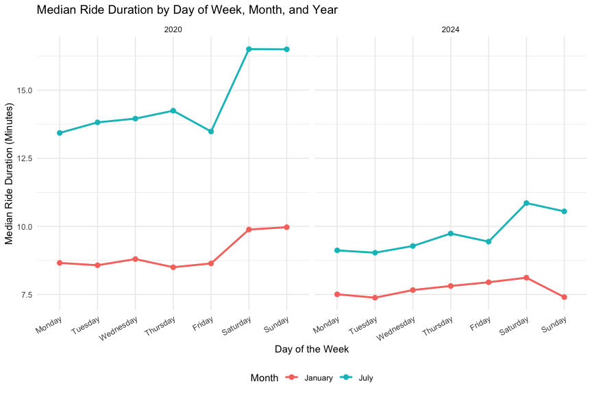
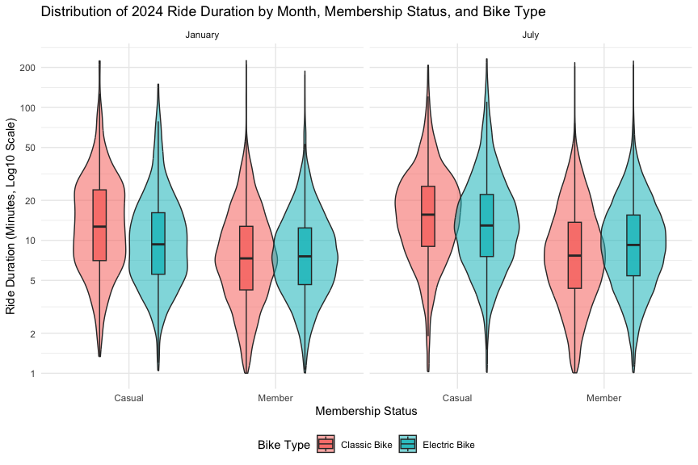

Homework 3
================
Zhiquan Chen

# Problem 1

``` r
data("ny_noaa")

noaa_missing =
  ny_noaa |>
  summarise(
    prop_prcp_na = mean(is.na(prcp)),
    prop_snow_na = mean(is.na(snow)),
    prop_snwd_na = mean(is.na(snwd)),
    prop_tmax_na = mean(is.na(tmax)),
    prop_tmin_na = mean(is.na(tmin))
  )

noaa_var_names = paste(sprintf("`%s`", names(ny_noaa)), collapse = ", ")
```

The `ny_noaa` dataset contains daily weather observations from 747 New
York state weather stations spanning from 1981-01-01 to 2010-12-31, with
2,595,176 rows and 7 columns (`id`, `date`, `prcp`, `snow`, `snwd`,
`tmax`, `tmin`). Key variables include weather station identifier
(`id`), observation date (`date`), precipitation in tenths of
millimeters (`prcp`), snowfall in millimeters (`snow`), snow depth in
millimeters (`snwd`), and maximum and minimum temperatures in tenths of
degrees Celsius (`tmax` and `tmin`). Missing data is a substantial issue
because many stations only record a subset of meteorological variables:
`tmax` and `tmin` are missing in 43.71% and 43.71% of observations,
`snwd` is missing in 22.80%, `snow` is missing in 14.69%, and `prcp` is
missing in 5.62%.

``` r
noaa_df =
  ny_noaa |>
  separate(
    date,
    into = c("year", "month", "day"),
    sep = "-",
    convert = TRUE
  ) |>
  mutate(
    prcp = prcp / 10,
    tmax = as.numeric(tmax) / 10,
    tmin = as.numeric(tmin) / 10
  )

snow_top =
  noaa_df |>
  filter(!is.na(snow)) |>
  count(snow, sort = TRUE) |>
  slice_head(n = 5)

next_snow_vals = paste(sprintf("`%d` mm", snow_top$snow[2:5]), collapse = ", ")

kable(
  snow_top,
  col.names = c("Snowfall (mm)", "Observations"),
  caption = "Top 5 Most Commonly Observed Snowfall Values"
)
```

| Snowfall (mm) | Observations |
|--------------:|-------------:|
|             0 |      2008508 |
|            25 |        31022 |
|            13 |        23095 |
|            51 |        18274 |
|            76 |        10173 |

Top 5 Most Commonly Observed Snowfall Values

I separated `date` into integer `year`, `month`, and `day` variables,
and converted `prcp` from tenths of millimeters to millimeters (`mm`) as
well as `tmax` and `tmin` from tenths of degrees Celsius to degrees
Celsius (`°C`), so that precipitation, snowfall, and snow depth are all
measured in `mm` and temperatures in `°C`. For snowfall, the most
commonly observed value is `0` mm (2,008,508 observations), because snow
does not fall on most days of the year in New York State. The next most
common values are `25` mm, `13` mm, `51` mm, `76` mm, which come from
original measurements recorded in inches (1, 0.5, 2, and 3 inches) and
rounded to the nearest millimeter after unit conversion.

``` r
jan_july_tmax =
  noaa_df |>
  filter(month %in% c(1, 7), !is.na(tmax)) |>
  mutate(
    month = factor(
      month,
      levels = c(1, 7),
      labels = c("January", "July")
    )
  ) |>
  group_by(id, year, month) |>
  summarise(
    mean_tmax = mean(tmax, na.rm = TRUE),
    .groups = "drop"
  )

ggplot(jan_july_tmax, aes(x = year, y = mean_tmax, group = id)) +
  geom_line(alpha = 0.15, color = "steelblue") +
  geom_point(alpha = 0.25, size = 0.8, color = "steelblue") +
  geom_smooth(aes(group = 1), color = "firebrick", se = FALSE, linewidth = 1) +
  facet_grid(. ~ month) +
  labs(
    title = "Station-Level Average Maximum Temperature in January and July (1981-2010)",
    x = "Year",
    y = "Average Maximum Temperature (°C)"
  )
```


The two-panel plot shows a clear seasonal separation: average maximum
temperatures in January generally fluctuate between -10 °C and 10 °C
(centered near 0 °C), whereas July average maximum temperatures stay
much warmer and more tightly clustered between 20 °C and 32 °C (centered
near 27 °C). Across stations, year-to-year fluctuations move in
parallel, reflecting statewide warm and cold years. There are also a few
clear outliers in both panels, such as a station in July 1988 with an
average maximum temperature around 14 °C and a station in January 1982
dropping below -13 °C.

``` r
tmax_tmin_plot =
  noaa_df |>
  filter(!is.na(tmax), !is.na(tmin)) |>
  ggplot(aes(x = tmin, y = tmax)) +
  geom_hex(bins = 50) +
  scale_fill_viridis_c(name = "Count", trans = "log10") +
  labs(
    title = "(i) Daily Maximum vs. Minimum Temperature",
    x = "Minimum Temperature (°C)",
    y = "Maximum Temperature (°C)"
  )

snow_dist_plot =
  noaa_df |>
  filter(snow > 0, snow < 100) |>
  mutate(year = factor(year)) |>
  ggplot(aes(x = snow, y = year, fill = after_stat(x))) +
  geom_density_ridges_gradient(scale = 2.2, rel_min_height = 0.01) +
  scale_fill_viridis_c(name = "Snowfall (mm)", option = "C") +
  labs(
    title = "(ii) Snowfall Distribution (0 < Snow < 100 mm) by Year",
    x = "Snowfall (mm)",
    y = "Year"
  ) +
  theme(legend.position = "none")

tmax_tmin_plot / snow_dist_plot
```


In panel (i), a hexagonal heatmap of `tmax` versus `tmin` avoids
overplotting across 1,458,900 complete pairs and shows a clear positive
linear relationship, with most daily observations concentrated between
`tmin` of -5 °C to 15 °C and `tmax` of 5 °C to 25 °C. In panel (ii), the
yearly ridge density plots of snowfall values between 0 and 100 mm stay
very consistent across all 30 years, with visible peaks around 13 mm, 25
mm, 51 mm, and 76 mm due to rounding from inches.

# Problem 2

``` r
covar_raw =
  read_csv(
    "Data/nhanes_covar.csv",
    skip = 4,
    na = c("", "NA"),
    col_types = cols(
      SEQN = col_integer(),
      sex = col_integer(),
      age = col_double(),
      BMI = col_double(),
      education = col_integer()
    )
  ) |>
  clean_names()

accel_raw =
  read_csv(
    "Data/nhanes_accel.csv",
    col_types = cols(
      .default = col_double(),
      SEQN = col_integer()
    )
  ) |>
  clean_names()

covar_df =
  covar_raw |>
  filter(age >= 21) |>
  drop_na(seqn, sex, age, bmi, education) |>
  mutate(
    sex = factor(
      sex,
      levels = c(1, 2),
      labels = c("Male", "Female")
    ),
    education = factor(
      education,
      levels = c(1, 2, 3),
      labels = c(
        "Less than high school",
        "High school equivalent",
        "More than high school"
      ),
      ordered = TRUE
    )
  )

nhanes_wide =
  covar_df |>
  inner_join(accel_raw, by = "seqn")

nhanes_long =
  nhanes_wide |>
  pivot_longer(
    cols = starts_with("min"),
    names_to = "minute",
    names_prefix = "min",
    names_transform = list(minute = as.integer),
    values_to = "mims"
  )
```

I skipped the first four metadata lines when importing
`nhanes_covar.csv`, standardized column names, excluded participants
younger than 21 years old (19 participants) and those with missing
demographic values (3 participants), and encoded `sex` and `education`
as ordered factors. Merging with the accelerometer file yielded 228
eligible participants across 1445 variables in wide format, and 328,320
participant-minute observations in tidy long format.

``` r
edu_sex_table =
  covar_df |>
  count(education, sex) |>
  pivot_wider(
    names_from = sex,
    values_from = n
  )

kable(
  edu_sex_table,
  col.names = c("Education Level", "Male", "Female"),
  caption = "Number of Men and Women in Each Education Category"
)
```

| Education Level        | Male | Female |
|:-----------------------|-----:|-------:|
| Less than high school  |   27 |     28 |
| High school equivalent |   35 |     23 |
| More than high school  |   56 |     59 |

Number of Men and Women in Each Education Category

``` r
ggplot(covar_df, aes(x = education, y = age, fill = sex)) +
  geom_boxplot(alpha = 0.6, width = 0.5, position = position_dodge(0.75), outlier.shape = NA) +
  geom_jitter(aes(color = sex), position = position_jitterdodge(jitter.width = 0.15, dodge.width = 0.75), alpha = 0.7) +
  labs(
    title = "Age Distributions by Sex and Education Level",
    x = "Education Level",
    y = "Age (Years)",
    fill = "Sex",
    color = "Sex"
  )
```


From the table, the “More than high school” group has the largest number
of participants, and the numbers of men and women are fairly balanced in
both the “Less than high school” and “More than high school” categories,
whereas men outnumber women in the “High school equivalent” group. The
age distribution plot shows that participants in the “More than high
school” group are generally younger overall (especially women, whose
median age is around 40 years) compared with the other two education
categories. In the “High school equivalent” category, women tend to be
older than men, while in “Less than high school” both men and women skew
toward older ages (with medians near 60 years).

``` r
total_activity_df =
  nhanes_long |>
  group_by(seqn, sex, age, bmi, education) |>
  summarise(
    total_activity = sum(mims, na.rm = TRUE),
    .groups = "drop"
  )

ggplot(total_activity_df, aes(x = age, y = total_activity, color = sex)) +
  geom_point(alpha = 0.65) +
  geom_smooth(method = "loess", se = FALSE, linewidth = 1) +
  facet_grid(. ~ education) +
  labs(
    title = "Total Daily Physical Activity vs. Age by Sex and Education Level",
    x = "Age (Years)",
    y = "Total Daily Activity (Sum of MIMS)",
    color = "Sex"
  )
```


Across all three education levels, total daily physical activity
decreases with age. In the “Less than high school” group, men and women
have similar activity levels with a steeper drop after age 60, whereas
in both the “High school equivalent” and “More than high school” groups,
women consistently record higher average total daily MIMS values than
men of the same age. Additionally, participants in the “High school
equivalent” category show a noticeable peak in total activity around
ages 35 to 45 before declining at older ages.

``` r
hourly_activity_plot =
  nhanes_long |>
  ggplot(aes(x = minute / 60, y = mims, color = sex)) +
  geom_line(
    stat = "summary",
    fun = mean,
    alpha = 0.35,
    linewidth = 0.4
  ) +
  geom_smooth(se = FALSE, linewidth = 1.1) +
  facet_grid(. ~ education) +
  scale_x_continuous(breaks = seq(0, 24, by = 4)) +
  labs(
    title = "24-Hour Physical Activity Profiles by Education Level and Sex",
    x = "Hour of Day (from Midnight)",
    y = "Activity Level (MIMS)",
    color = "Sex"
  )

hourly_activity_plot
```


The 24-hour activity profiles show a clear daily pattern across all
three education groups: activity is lowest overnight between midnight
and 5:00 AM, rises sharply between 6:00 AM and 9:00 AM, stays high
throughout the daytime (9:00 AM to 6:00 PM), and drops off during the
evening. In the “High school equivalent” and “More than high school”
panels, women maintain noticeably higher daytime MIMS levels than men
from mid-morning through early evening, whereas in the “Less than high
school” group, men and women follow very similar curves throughout the
day.

# Problem 3

``` r
import_citibike = function(file_path, year_val, month_val) {
  read_csv(
    file_path,
    col_types = cols(
      ride_id = col_character(),
      rideable_type = col_character(),
      weekdays = col_character(),
      duration = col_double(),
      start_station_name = col_character(),
      end_station_name = col_character(),
      member_casual = col_character()
    )
  ) |>
    clean_names() |>
    mutate(
      year = factor(year_val),
      month = factor(month_val, levels = c("January", "July"))
    )
}

citibike_df =
  bind_rows(
    import_citibike("Data/citibike/Jan 2020 Citi.csv", 2020, "January"),
    import_citibike("Data/citibike/July 2020 Citi.csv", 2020, "July"),
    import_citibike("Data/citibike/Jan 2024 Citi.csv", 2024, "January"),
    import_citibike("Data/citibike/July 2024 Citi.csv", 2024, "July")
  ) |>
  mutate(
    weekdays = factor(
      weekdays,
      levels = c(
        "Monday", "Tuesday", "Wednesday", "Thursday",
        "Friday", "Saturday", "Sunday"
      ),
      ordered = TRUE
    ),
    rideable_type = factor(
      rideable_type,
      levels = c("classic_bike", "electric_bike"),
      labels = c("Classic Bike", "Electric Bike")
    ),
    member_casual = factor(
      member_casual,
      levels = c("casual", "member"),
      labels = c("Casual", "Member")
    )
  )

citibike_var_names = paste(sprintf("`%s`", names(citibike_df)), collapse = ", ")
```

I imported the four Citi Bike files, standardized their column names,
added `year` and `month` identifiers, and encoded `weekdays`,
`rideable_type`, and `member_casual` as factors. The combined dataset
contains 99,485 rides and 9 variables: `ride_id`, `rideable_type`,
`weekdays`, `duration`, `start_station_name`, `end_station_name`,
`member_casual`, `year`, `month`. Across all records,
`start_station_name` is missing in 43 rides and `end_station_name` is
missing in 207 rides, while all other variables are complete.

``` r
rides_summary_table =
  citibike_df |>
  count(year, month, member_casual) |>
  pivot_wider(
    names_from = member_casual,
    values_from = n
  ) |>
  mutate(Total = Casual + Member)

get_stat = function(yr, mo, col) {
  rides_summary_table |>
    filter(year == yr, month == mo) |>
    pull({{ col }})
}

pct_jul20 = get_stat("2020", "July", Member) / get_stat("2020", "July", Total) * 100
pct_jan20 = get_stat("2020", "January", Member) / get_stat("2020", "January", Total) * 100

cas_jan20 = get_stat("2020", "January", Casual)
cas_jul20 = get_stat("2020", "July", Casual)
cas_jan24 = get_stat("2024", "January", Casual)
cas_jul24 = get_stat("2024", "July", Casual)

kable(
  rides_summary_table,
  col.names = c("Year", "Month", "Casual Riders", "Citi Bike Members", "Total Rides"),
  format.args = list(big.mark = ","),
  caption = "Total Number of Citi Bike Rides by Year, Month, and Membership Status"
)
```

| Year | Month   | Casual Riders | Citi Bike Members | Total Rides |
|:-----|:--------|--------------:|------------------:|------------:|
| 2020 | January |           984 |            11,436 |      12,420 |
| 2020 | July    |         5,637 |            15,411 |      21,048 |
| 2024 | January |         2,108 |            16,753 |      18,861 |
| 2024 | July    |        10,894 |            36,262 |      47,156 |

Total Number of Citi Bike Rides by Year, Month, and Membership Status

Ridership grew substantially between 2020 and 2024 and shows a strong
seasonal pattern: July ride counts are roughly double to triple those in
January within the same year. Citi Bike members account for the majority
of rides in every period (ranging from 73.2% in July 2020 to 92.1% in
January 2020), while casual ridership increases much more sharply in the
summer (growing from 984 rides in January 2020 to 5,637 in July 2020,
and from 2,108 in January 2024 to 10,894 in July 2024).

``` r
top5_july2024_stations =
  citibike_df |>
  filter(year == "2024", month == "July", !is.na(start_station_name)) |>
  count(start_station_name, name = "n_rides", sort = TRUE) |>
  slice_head(n = 5)

station_strings = sprintf(
  "`%s` (%d rides)",
  top5_july2024_stations$start_station_name,
  top5_july2024_stations$n_rides
)

top5_stations_text = paste0(
  paste(station_strings[1:4], collapse = ", "),
  ", and ",
  station_strings[5]
)

kable(
  top5_july2024_stations,
  col.names = c("Starting Station Name", "Number of Rides"),
  caption = "Top 5 Most Popular Starting Stations in July 2024"
)
```

| Starting Station Name    | Number of Rides |
|:-------------------------|----------------:|
| Pier 61 at Chelsea Piers |             163 |
| University Pl & E 14 St  |             155 |
| W 21 St & 6 Ave          |             152 |
| West St & Chambers St    |             150 |
| W 31 St & 7 Ave          |             146 |

Top 5 Most Popular Starting Stations in July 2024

In July 2024, the five most popular starting stations are
`Pier 61 at Chelsea Piers` (163 rides), `University Pl & E 14 St` (155
rides), `W 21 St & 6 Ave` (152 rides), `West St & Chambers St` (150
rides), and `W 31 St & 7 Ave` (146 rides).

``` r
median_duration_df =
  citibike_df |>
  group_by(year, month, weekdays) |>
  summarise(
    median_duration = median(duration, na.rm = TRUE),
    .groups = "drop"
  )

ggplot(median_duration_df, aes(x = weekdays, y = median_duration, color = month, group = month)) +
  geom_line(linewidth = 1) +
  geom_point(size = 2.2) +
  facet_grid(. ~ year) +
  labs(
    title = "Median Ride Duration by Day of Week, Month, and Year",
    x = "Day of the Week",
    y = "Median Ride Duration (Minutes)",
    color = "Month"
  ) +
  theme(axis.text.x = element_text(angle = 30, hjust = 1))
```



Median ride duration is consistently longer in July than in January
across both 2020 and 2024, and peaks noticeably on weekends (Saturday
and Sunday) compared with weekdays (Monday through Friday), as riders
take more leisure trips on weekends and in summer. Moreover, overall
median ride durations in 2024 are shorter than in 2020 (especially in
July, dropping from around 13–16.5 minutes in July 2020 to 10–12 minutes
in July 2024).

``` r
citibike_df |>
  filter(year == "2024") |>
  ggplot(aes(x = member_casual, y = duration, fill = rideable_type)) +
  geom_violin(alpha = 0.55, position = position_dodge(0.8), trim = TRUE) +
  geom_boxplot(width = 0.18, position = position_dodge(0.8), outlier.shape = NA, alpha = 0.8) +
  facet_grid(. ~ month) +
  scale_y_continuous(trans = "log10", breaks = c(1, 2, 5, 10, 20, 50, 100, 200)) +
  labs(
    title = "Distribution of 2024 Ride Duration by Month, Membership Status, and Bike Type",
    x = "Membership Status",
    y = "Ride Duration (Minutes, Log10 Scale)",
    fill = "Bike Type"
  )
```



For 2024 rides (plotted on a log-10 scale due to right skewness), casual
riders consistently take longer trips than Citi Bike members across both
months and bike types, since members more often use bikes for short
daily commutes. Trips in July have slightly longer median durations and
wider upper tails than in January. Comparing bike types, casual riders
using classic bikes have noticeably longer ride durations than those
riding electric bikes, whereas among members, ride duration
distributions between electric and classic bikes are very similar, with
electric bikes showing slightly shorter durations in January.
